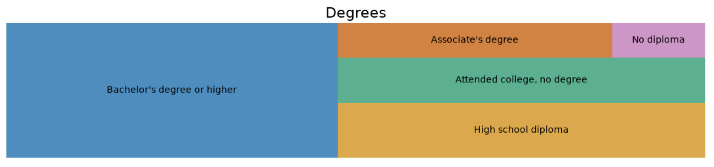
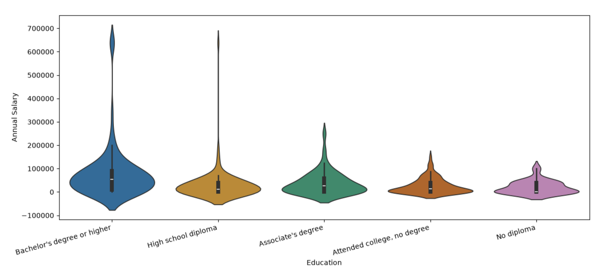
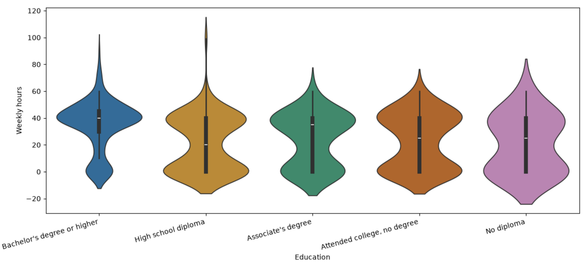

# Education, Salary, and Working Hours Analysis

## 📌 Problem or Research Question
This project aims to explore how **Education Level** affects an individual's **Annual Salary** and **Weekly Working Hours**. 
The main research questions are:
1. Does a higher education level guarantee a higher annual salary?
2. Are there significant differences in weekly working hours among different education groups?

## 📊 Dataset Source and Usage Permissions
*   **Source**:Kaggle dataset "age_salary_hours.csv" 
*   **Usage Permissions**: The dataset is publicly available and permitted for educational, analytical, and portfolio demonstration purposes.

## 🛠️ Methods and Tools Used
*   **Programming Language**: Python
*   **Data Manipulation**: Pandas
*   **Data Visualization**: Matplotlib, Seaborn (Violin plots), Squarify (Treemap)
*   **Analysis Method**: Exploratory Data Analysis (EDA) to observe data distribution, medians, and probability density across different categorical variables.

## 💡 Key Findings and Limitation
**Key Findings:**
**Key Findings:**





1.  **Education Distribution**: The vast majority of the sample holds a "Bachelor's degree or higher", followed by a "High school diploma".
2.  **Salary Differences**: There is a clear positive correlation between education and salary. The group with a "Bachelor's degree or higher" shows a significantly higher median and upper bound in annual salary compared to other groups. However, the variance within this highly educated group is also the largest.
3.  **Working Hours**: Interestingly, the distribution of "Weekly hours" does not vary drastically across different education levels. Most individuals across all groups work around 40 hours per week.

**Limitation:**
*   The data may have sample bias (e.g., the sample size for higher education is much larger than others) and does not account for confounding variables such as industry, geographical location, or years of experience. Additionally, there are extreme outliers (e.g., salaries reaching 700,000 or going negative) which could skew the average.

## 🚀 Instructions for Running the Analysis
To run this analysis locally, please follow these steps:

1. Clone this repository:
   ```bash
   git clone https://github.com/WEIYI0904/data-science-project.git
   ```
